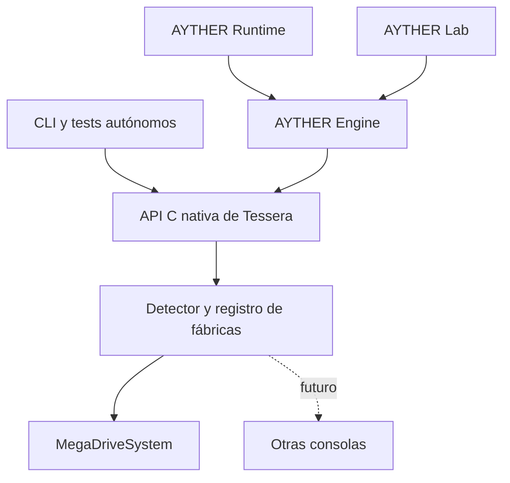

# Plan técnico de implementación — MVP de AYTHER Tessera

**Característica:** `001-mvp-core`  
**Fecha y aprobación:** 2026-10-19  
**Alineación aprobada:** diez correcciones de QA de la especificación y la constitución.  
**Estado:** aprobado; fases 0–4 completadas localmente, con ClownMDEmu seleccionado, Engine nativo, replay/checkpoints Mega Drive y observación/sustitución FX-03 validados. Fase 5 en curso: T033 cerrada; Runtime (T030/T031), mediciones (T032) y entrega (T034–T036) pendientes.
**Especificación:** [spec.md](spec.md).  
**Norma aplicable:** [docs/constitution.md](../../docs/constitution.md).

## Resumen

Construir un núcleo C++20 con API C nativa y CLI de validación. Engine consume
Tessera directamente y conserva identificación de recursos, paquetes `.ay` y
composición HD. Runtime y Lab consumen Engine. Tessera detecta la consola del
contenido, despacha su implementación y entrega emulación, observación, estados
y controles seguros. La ruta nativa no requiere libretro ni traducción de
capturas a `ayther_interface_v1`.

El MVP entrega Windows x64 y Mega Drive. El backend sintético prueba contratos;
no representa otra consola. Otros sistemas, sustitución sonora, editor nuevo,
red y multijugador siguen fuera del alcance. La infraestructura sonora existente
de Engine conserva su propietario sin ampliar el MVP.

La implementación hasta Gate 3 y sus resultados locales constan en
[fase 3](../../docs/phase-3-results.md). La integración de presentación y Runtime
se ejecutará en las fases siguientes.

## Contexto técnico

| Área | Decisión aprobada |
| --- | --- |
| Lenguaje | C++20 y biblioteca estándar; API pública C. |
| Windows | `clang-cl` o MSVC sobre ABI MSVC y toolset v145 14.51 o posterior. Fijar versión y opciones exactas tras comprobar un enlace real. |
| Construcción | CMake y Ninja, builds fuera de fuentes y dependencias por target. Referencia local observada: CMake 4.3.3 y Ninja 1.13.2. |
| Entrega | Biblioteca instalable `Tessera::core`, API C y `tessera-cli`. Engine consume el paquete instalado. |
| Datos de pruebas e informes | nlohmann/json 3.12.0, MIT, para trazas e informes; no define otro paquete gráfico. |
| Hashes | PicoSHA2 1.0.1, MIT, para SHA-256. |
| Tests | doctest 2.5.3, MIT, y CTest. |
| Persistencia | Archivos locales explícitos, versionados y validados; sin punteros ni dumps del compilador. |
| Paquetes y presentación | `.ay`, validación y composición HD de Engine. |
| Plataforma y escala | Windows x64, Mega Drive, una sesión conducida por un propietario y corpus autorizado declarado. |
| Rendimiento | Medir antes de fijar presupuestos; sin porcentajes de mejora ni FPS prometidos. |

Cada dependencia incorpora versión, SHA-256, licencia, procedencia y justificación.
El Clang MinGW observado localmente no es el toolchain elegido para enlazar los
paquetes C++ actuales de Engine. La integración fija además versiones de Engine
y Runtime: se observaron Runtime beta.12 y el lock Engine rc.18, todavía sin esta
integración nativa. Los paquetes nuevos deben demostrar compatibilidad.

Presets previstos: `windows-dev`, `windows-release`, `windows-diagnostics`,
`windows-engine-integration` y `windows-runtime-integration`. Son entregables
futuros, no configuraciones de compilación ya funcionales.

## Comprobación de la constitución

| Principio | Aplicación y comprobación |
| --- | --- |
| Stack mínimo | Biblioteca estándar y dependencias acotadas justificadas; reutilizar `.ay` y presentación de Engine. |
| Spec primero | RF-01–RF-13, RC-01–RC-05 y CA-01–CA-11 preceden al código y se trazan a tests. |
| Lógica independiente | Núcleo y CLI sin Engine ni UI; Engine es consumidor, no dependencia de Tessera. |
| Tests obligatorios | CI crece por fase: unidad, contratos, replay y regresiones; cada bug corregido añade prueba. |
| Persistencia explícita | Formatos validados, guardado atómico incluido el primero, errores de E/S explícitos, carga transaccional, tres checkpoints y procesos nuevos. |
| Idioma consistente | Código, comentarios y logs propios nuevos en inglés; documentación y mensajes al usuario en español. Fuentes externas conservan idioma, avisos y procedencia; sus copias de referencia permanecen intactas. |

La comprobación documental es conforme antes y después del diseño. Los gates
técnicos siguen pendientes. La norma es `docs/constitution.md`; la plantilla
pendiente de `.specify/memory/constitution.md` no la sustituye.

## Arquitectura y responsabilidades



| Componente | Propietario y responsabilidad |
| --- | --- |
| Máquina y sesión determinista | Tessera: ciclo de vida, entradas, reloj lógico, frame y estado emulado. |
| Detección y despacho | Tessera: probe, `SystemId`, registro de implementaciones y fábrica. |
| Observación | Tessera: capturas inmutables, geometría, épocas, eventos y pérdidas. |
| Controles seguros | Tessera: validación y aplicación atómica de controles soportados al comienzo del frame, sin alterar la evolución emulada. |
| Sesión de producto | Engine: coordina Tessera con recursos, grabación y políticas de presentación. |
| Recursos y HD | Engine: identidades, `.ay`, validación, sustitución, composición y respaldo original. |
| Aplicaciones | Runtime y Lab: interfaz y consumo de Engine. La aceptación incluye Runtime; no se desarrolla un editor nuevo. |
| CLI | Tessera: consumidor de la misma API para verificar el núcleo. |

Engine incorpora un módulo privado `TesseraBackend` para administrar handles y
consumir los datos nativos. Se generalizan los puntos hoy asociados a `core_path`,
`RetroRunner` y `EmulationObserver`. `RetroRunner` puede coexistir para núcleos
existentes; no se elimina antes de demostrar el consumo nativo. El proveedor se
elige explícitamente y no cambia silenciosamente ante un error.

### Detección y despacho por consola

`Contenido → SystemDetector → SystemId → SystemRegistry → fábrica → IEmulatedSystem`.

El detector inspecciona estructura y contenido y conserva evidencias. Su resultado
es reconocido, desconocido, ambiguo o inválido; la extensión es orientativa. El
registro declara implementaciones y capacidades y crea `MegaDriveSystem` mediante
una fábrica. Sistema y backend tienen identidades distintas. La selección
explícita se valida y registra con contenido, versión y configuración.

Se detecta al abrir contenido; la sesión conserva la implementación, sin repetir
el reconocimiento por frame o instrucción. El backend sintético es un perfil de
prueba explícito. Una consola nueva exige detector, implementación y corpus.

### Contrato, capturas y ejecución

La [API C nativa](contracts/native-api.md) declara handles opacos, versión/tamaño,
capacidades, errores, propiedad y vigencia. No cruza tipos internos de Engine,
contenedores STL ni excepciones.

Un propietario avanza la máquina con reloj lógico. Engine coordina sus políticas
con las transacciones nativas al comienzo del frame; no activa media transacción
ni aplica dos veces una sustitución. Las entradas del juego pueden modificar la
máquina; presentación y observación no lo hacen.

Cada avance recibe el estado completo de los controles configurados para el
próximo frame de la época actual, con una asignación por puerto y control.
Las trazas contienen frames consecutivos 1…N y se validan antes de reproducirlas.
Duplicados, conjuntos incompletos, contradicciones, entradas tardías, futuras o
de época obsoleta se rechazan sin avanzar ni aplicar controles pendientes.
`END_OF_TRACE` deja la sesión pausada sin otro frame; CA-02 exige los 3.000
frames completos. El primer avance completa el frame 1; un checkpoint K
continúa en K+1.

Reiniciar reconstruye el estado inicial registrado al abrir, con las mismas
identidades, configuración y datos iniciales de memoria persistente cuando
correspondan. El éxito crea una época nueva, deja cero frames completados,
entradas neutrales, cursor de replay al inicio y la sesión pausada; descarta
entradas pendientes de la época anterior. Un fallo conserva íntegramente la
sesión y su transacción pendiente. Los controles nativos vuelven a neutro al
reiniciar; Engine conserva el paquete y rearma su política en la nueva época
mediante una transacción confirmada antes de presentar el frame correspondiente.

La sesión admite una transacción pendiente, identificada por sesión, época y
frame objetivo. Otra solicitud se rechaza con `CONTROL_PENDING`, sin reemplazo
ni cambios efectivos. La aceptada permanece pendiente durante pausa y se aplica
completa al próximo frame válido ejecutado, con confirmación de identidad,
época y frame. Reinicio, restauración y cierre exitosos cancelan la pendiente
con identidad y causa en el resultado de la operación, fuera de la cola de
eventos saturable; reinicio/restauración fallidos la conservan.

Las capturas incluyen sesión, época y generación. Las retenidas son inmutables
hasta liberarse. Restaurar invalida su uso como captura actual, sin permitir
punteros colgantes a datos históricos. Pools y colas tienen límites y agotamiento
observables. Lectores lentos no bloquean la máquina; ante información temporal
incompleta Engine presenta el original completo.

Engine conserva las reglas de precedencia: para tiles, override de ejecución
aplicable antes del catálogo y primera entrada `[[sub]]` aplicable según orden
declarado; para sprites superpuestos, orden SAT y prioridad respecto de planos.
Los demás tipos admitidos identifican el contrato versionado de Engine que
determina su precedencia y desempate. FX-03 declara coincidencias y solapamientos
con ganador y píxeles esperados explícitos, repetibles entre procesos; Tessera
no duplica estas políticas.

Se agrupan operaciones por frame y bloques de audio, se reutilizan buffers y se
produce la observación solicitada por suscripciones. El formateo/escritura de logs
sale del camino crítico. No se omite información necesaria para declarar exacta
una reconstrucción para obtener una mejora aparente de rendimiento.

### Persistencia y hashes

El estado identifica contenido, configuración, backend y versiones, y conserva
temporización y audio pendiente necesarios para continuar. Un blob del backend
no se acepta sin auditar formato y continuidad.
El checkpoint conserva máquina y contexto de replay, excluyendo presentación
HD y transacciones pendientes. Exportarlo no aplica ni cancela la pendiente de
la sesión que continúa ejecutándose.

Se escribe un temporal en el mismo volumen y se reemplaza el destino con una
operación de Windows validada mediante fallos inducidos. La carga restaura una
instancia candidata antes de reemplazar la sesión activa. Una restauración o
un reinicio exitosos crean otra época e invalidan datos actuales afectados;
sus fallos conservan la sesión anterior y su transacción pendiente.

Ante interrupción del proceso, un destino previamente válido conserva el
archivo anterior o contiene el nuevo completo; en el primer guardado queda
ausente o contiene el nuevo completo. Nunca se acepta un archivo parcial ni un
temporal incompleto como checkpoint publicado. Un error anterior a publicar
conserva el destino previo o su ausencia; el guardado solo comunica éxito tras
publicar el archivo completo. Lectura, escritura y publicación devuelven código
estable, fase y diagnóstico del sistema operativo, distinguiendo espacio
insuficiente, acceso denegado y fallo de publicación. Los fallos de lectura o
restauración conservan la sesión. La garantía cubre proceso y E/S; no incluye
durabilidad ante pérdida de alimentación.

Los hashes canónicos fijan campos y orden de bytes del estado, vídeo sin padding
de pitch y formato/canales/cantidad de muestras de audio. Excluyen punteros,
padding, identidad de sesión y datos del observador. La presentación HD se compara
por separado. CI y diagnóstico conservan hashes completos de validación; la
reproducción mantiene las identidades necesarias para Engine.

## Fases y condiciones de cierre

| Fase | Entregables | Gate |
| --- | --- | --- |
| 0. Contratos y viabilidad | Alinear spec, responsabilidades, API y toolchain; comparar dos backends con estímulos conocidos de T005. | Contratos verificables, respuesta funcional esperada del candidato, selección documentada y vínculo de prueba Engine–Tessera con ABI compatible. |
| 1. Núcleo sintético | API, sesión, CLI, detector/registro básicos, FX-01 y CI. | Capacidades presentes/ausentes, reset conocido, entradas completas y negativas, fin de traza, pendiente única y cancelación por reinicio/cierre; contratos y 3.000 frames completos aprobados. |
| 2. Integración nativa temprana | Engine consume la implementación sintética de Tessera. | Carga, entradas, reset/frame, capturas, audio, resultados y ciclo de vida nativos equivalentes; sin libretro en esa ruta. |
| 3. Mega Drive y estados | Backend real, ROM copiada, FX-02, replay y persistencia. | Oráculos funcionales independientes en API autónoma y Engine, 3.000 frames, tres checkpoints con audio activo, primer guardado y errores E/S, exclusión de pendientes y cancelación/conservación al restaurar. |
| 4. Sustitución integrada | FX-03, observación en Engine, controles, respaldo e invalidación. | Precedencia y solapamientos con píxeles esperados entre procesos, hashes originales conservados, rearme tras reinicio y coordinación de presentación después de restaurar. |
| 5. Rendimiento y entrega | Perfiles, robustez, presentación en Runtime y paquete final. | Tests aprobados, fixtures completos, métricas con definiciones/unidades/origen/cobertura, idiomas y procedencia verificados y distribución probada en entorno limpio. |

Tests y mediciones básicas acompañan cada fase; la fase 5 consolida evidencia.
Se mantienen T001–T036 y sus dependencias. T012 cierra transacciones con
reinicio/cierre; T023–T024 añaden restauración y T029 comprueba su coordinación
con la presentación de Engine. T021 usa el estado observable expuesto al
integrar T019; no espera la reconstrucción temporal HD de T025.

### Gate 0 del backend real

Comparar ares y ClownMDEmu con revisiones y dependencias fijadas. ares v148,
commit `0aafd85789215e84e1e43415c07d4c88461b7899`, es preferencia de evaluación,
no una selección ni integración técnicamente demostrada. Se inventariarán sus
componentes enlazados y licencias. ClownMDEmu declara AGPLv3+; una API C o un
módulo privado no eliminan sus obligaciones.

El candidato debe probar frame, entradas, vídeo/audio originales, observación,
controles y restauración sin persistir punteros, padding o pilas de ejecución.
Los estímulos de T005 incluyen entrada de efecto conocido y control sin ella,
con expectativas documentadas a partir de la fuente o generador antes de
contrastarlas con el candidato; se reutilizan al completar FX-02 en T020.
Se auditan temporización, filtros, remuestreo y audio pendiente. Un snapshot final
de VRAM/CRAM/SAT no demuestra todos los efectos temporales: se exige evidencia
suficiente o respaldo. No se integra un candidato que falle capacidades obligatorias.

## Fixtures y tests

| Fixture | Estado y trabajo obligatorio |
| --- | --- |
| Demo Engine/Lab copiada | ROM de 32 KiB y fuentes intactas con hashes; ejecución de 3.000 frames y continuaciones verificada por Tessera y Engine. No programa FM/PSG. |
| FX-01 | Recorrido autónomo y Engine validado: perfiles mínimo/completo, entradas/control, trazas completas, reset y tres checkpoints K→K+1. |
| FX-02 | Demo sonora separada, propia MIT, con fuentes/hashes, acción B y control, estado observable, vídeo y actividad/transiciones PCM. Oráculos independientes aprobados por API autónoma y Engine; silencio constante falla. |
| FX-03 | Pendiente: `.ay` gráfico real para Engine–Tessera, imagen autorizada, identidad real de ROM y metadatos; coincidencias y recursos superpuestos con precedencia, ganador y píxeles esperados explícitos, repetibles entre procesos y validados también en Runtime. |

El pack actual contiene texto y no satisface FX-03. Antes de publicar se
registran los permisos específicos de los artefactos generados. Resultados
históricos de Engine/Lab no sustituyen evidencia nueva con Tessera.

| Nivel | Verificación y trazabilidad |
| --- | --- |
| Unidad/contrato | Rangos, capacidades, formatos, ownership, vigencia, reset inicial, entradas completas y negativas, EOF, pendiente única, confirmaciones y cancelaciones; RF-01/03/04/06/09/10/11/12. |
| Replay | Dos procesos, 3.000 frames completos, tres hashes sin divergencias y oráculos independientes de entrada/estado observable/vídeo/audio en FX-01 y FX-02, por API autónoma y Engine; RF-02, CA-02/06/10. |
| Restauración | Frames 500/1.500/2.500 después de completar K, proceso nuevo y 500 frames desde K+1; máquina/replay sin HD ni pendientes, exportación sin cancelación, cancelación al restaurar y conservación ante fallo; RF-09, CA-03/07. |
| Detección | ROM renombrada, extensión falsa, truncado, ambigüedad, override incompatible y backend ausente; RF-11, CA-09. |
| Observación | Activa/inactiva, dos lectores, siguiente frame, restauración, cierre y saturación; CA-04 y contrato nativo. |
| Engine | Consumo nativo, `.ay`, precedencia/solapamientos, sustitución, rechazo, pendientes, rearme tras reinicio, coordinación después de restaurar, invalidación y respaldo; RF-05/07/08/12, CA-05/10. |
| Runtime | Recorrido completo en perfil declarado; entradas y resultados, presentación, controles y métricas definidas de entrega y audio. |
| Robustez | Estados/paquetes corruptos, rutas externas, límites, primer guardado y reemplazo interrumpidos, fallos de lectura/espacio/permisos/publicación y conservación de sesión/pendiente; CA-07. |
| Distribución | Instalar el paquete y compilar/ejecutar consumidor en entorno limpio con fuentes y avisos; CA-08. |

CI separa núcleo sin GPU, integración con Engine y presentación de Runtime.
No disponer de recursos requeridos no convierte la prueba en aprobada. Se
documenta la cobertura de sanitizers y los diagnósticos disponibles hacen fallar
la validación. Cada corrección de bug añade su regresión.

## Mediciones de rendimiento

Separar carga/guardado de ejecución estable. Instrumentar progresivamente
emulación, salidas originales, observación, capturas, hashing y composición.
La medición no participa en el reloj lógico ni en las decisiones emuladas.

Publicar p50/p95/p99 por frame y etapa, memoria máxima, asignaciones, bytes
copiados por frame, volumen/pérdidas de eventos, respaldos, regularidad de
entrega a presentación y cortes de audio. En Runtime separar CPU, GPU y espera de
presentación; no sumar tiempos solapados como latencia secuencial.

La regularidad mide intervalos entre entregas consecutivas al presentador de
Runtime, en milisegundos y con reloj monotónico: p50/p95/p99 y máximo. Los
timestamps de presentación efectiva disponibles forman otra serie con origen
identificado. Un corte es un intervalo continuo en el que el dispositivo
solicita muestras que Runtime no tiene disponibles a tiempo; registrar episodios,
muestras faltantes y duración total/máxima. El silencio previsto por el fixture
es válido. Cada serie declara punto de instrumentación, origen y cobertura;
las métricas de dispositivo/presentación pertenecen a los consumidores y no
forman parte del estado lógico de Tessera.

Registrar hardware, sistema, toolchain/opciones, binarios/revisiones, contenido,
traza, configuración, calentamiento, repeticiones y cantidad de muestras. El
runner autónomo mide sin limitador; Runtime también mide presentación regulada.

Comparar Tessera autónoma y la misma Tessera consumida por Engine, activando
etapas progresivamente. Una diferencia libretro/nativa se atribuye a integración
solo con el mismo backend y condiciones. En otro caso la ruta anterior es una
referencia de producto separada; no se exige otro wrapper libretro para medirla.

Primero comprobar resultados y hashes equivalentes; después derivar presupuestos
y umbrales de la base y variación medidas. Omitir audio, observación necesaria o
sustitución no supera la aceptación. RF-13 y CA-11 requieren publicar mediciones,
no alcanzar un incremento arbitrario de FPS.

## Validación local y costo de integración

Se conserva la política de [tasks.md](tasks.md): validación local por hito,
una compilación activa con paralelismo inicial 2 ajustable a memoria medida,
builds incrementales y cachés verificadas; benchmarks aislados de otras cargas.
Las nuevas comprobaciones se integran en las suites existentes, conservando
todos los checks obligatorios de CI y evidencia compacta.

El objetivo sigue siendo tres PR coordinados, uno por repositorio afectado
(Tessera, Engine y Runtime). Cualquier adicional debe ser imprescindible y
justificado en T035. Agrupar pushes, reutilizar paquetes locales, publicar solo
los artefactos necesarios para la cadena real y evitar PR, tags, releases,
matrices o ejecuciones periódicas por tarea.

## Estructura prevista

### Documentación

```text
specs/001-mvp-core/
  spec.md
  plan.md
  research.md
  data-model.md
  contracts/native-api.md
  tasks.md
  quickstart.md
  checklists/requirements.md
```

[Decisiones](research.md), [modelo de datos](data-model.md),
[contrato nativo](contracts/native-api.md), [tareas](tasks.md) y
[guía de validación](quickstart.md). Las 36 tareas siguen pendientes; esta
alineación documental no implementa código ni ejecuta los checks del MVP.

### Código y pruebas a implementar

```text
include/tessera/          API C pública
src/domain/              identidades, resultados y capacidades
src/session/             máquina, entradas y transacciones
src/systems/             detector, registro y fábricas
src/backends/synthetic/  implementación de contratos
src/backends/megadrive/  implementación seleccionada de Mega Drive
src/observation/         capturas y eventos nativos
src/persistence/         formatos y almacenamiento
src/cli/                 consumidor autónomo de la API
tests/unit/
tests/contract/
tests/integration/
tests/performance/
tests/fixtures/
cmake/                   presets, exportación y dependencias
legal/                   inventario, procedencia y avisos
```

Es un destino de implementación, no un inventario existente. `TesseraBackend`
y los cambios de consumo pertenecen a Engine; Runtime sigue dependiendo de Engine.

## Seguimiento de complejidad y aprobación

No se aprueban excepciones a la constitución. Backend real, toolchain exacto y
presupuestos posteriores son gates explícitos, no verificaciones terminadas.
RF-05/07/08 conservan sus resultados con propiedad en Engine–Tessera.
RF-11/12/13 y CA-09/10/11 añaden detección, consumo nativo y rendimiento.
La siguiente descomposición de trabajo parte de esta spec y este plan aprobados.
