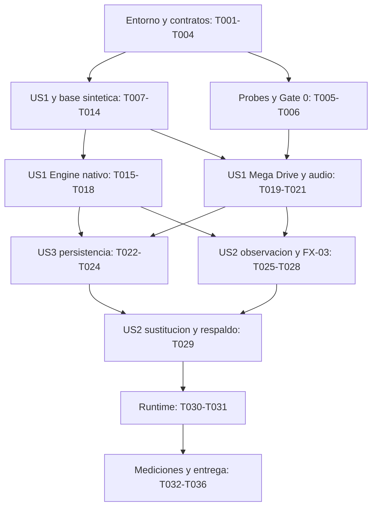

# Tareas de implementación — MVP de AYTHER Tessera

**Característica:** `001-mvp-core`  
**Aprobación:** 2026-10-19; 36 tareas aprobadas por el usuario.  
**Alineación aprobada:** diez correcciones de QA, conservando tareas, fases y dependencias.  
**Estado:** fases 0–4 y T030/T033/T034 verificadas localmente. T031 mantiene pendiente el perfil físico en CI; T032, T035 y T036 siguen abiertos. Resultados en [fase 3](../../docs/phase-3-results.md), [fase 4](../../docs/phase-4-progress.md) y [línea base](../../docs/performance-baseline.md).
**Fuentes:** [especificación](spec.md), [plan técnico](plan.md), [investigación](research.md),
[modelo de datos](data-model.md), [contrato nativo](contracts/native-api.md) y
[guía de validación](quickstart.md).  
**Norma:** [constitución aprobada](../../docs/constitution.md); la plantilla de
`.specify/memory/constitution.md` no la sustituye.

## Alcance y forma de ejecución

Se conservan las fases 0–5 y los identificadores T001–T036 de la propuesta aprobada.
El MVP completo exige las tres historias P1, integración nativa Engine→Tessera,
Runtime→Engine→Tessera y todos los fixtures; FX-01 por sí solo es un incremento
de validación, no el MVP terminado.

| Etiqueta | Historia de la especificación | Prueba independiente |
| --- | --- | --- |
| US1 | Ejecutar y reproducir una sesión. | CLI y Engine: ciclo de vida, reset al estado inicial registrado, detección, entradas completas y negativas, EOF, 3.000 frames completos en dos procesos y oráculos independientes de FX-01/FX-02. |
| US2 | Inspeccionar y sustituir un recurso. | Dos lectores sin interferencia; pendiente única, confirmación/cancelación y Engine con/sin FX-03, precedencia/solapamientos/píxeles esperados, respaldo y presentación final en Runtime. |
| US3 | Guardar y continuar una sesión. | Checkpoints 500/1.500/2.500 posteriores a K, proceso nuevo y 500 frames desde K+1; exclusión de HD/pendientes, exportación sin cancelación, primer guardado y errores E/S sin cambio parcial. |

Las tareas comunes no llevan etiqueta de historia. `[P]` indica una oportunidad
de trabajo simultáneo en archivos distintos **después de satisfacer las
dependencias de la tabla**, no una autorización para saltarlas. Las tareas de
cada fase están agrupadas por fundamento o historia; los tests específicos se
escriben antes de la implementación que verifican y se ejecutan con ella.

Las rutas relativas pertenecen a `C:/ayther/AYTHER-Tessera`. Las rutas absolutas
de Engine y Runtime identifican trabajo en esos repositorios, no dependencias
inversas del núcleo. Las rutas de código y pruebas son destinos previstos;
guardar este documento no los crea ni acredita su funcionamiento.

## Recursos locales y costo de integración

- Priorizar edición, compilación incremental y prevalidación en el equipo local.
  T001 verificará RAM disponible, GPU, Vulkan y entorno de herramientas x64;
  no se deducen de la cantidad de procesadores lógicos.
- Mantener una compilación activa, comenzar con `--parallel 2` y ajustar según
  memoria máxima y presión de recursos observadas. Limitar a dos frentes de
  edición independientes. Ejecutar benchmarks y pruebas sensibles a GPU/audio
  sin compilaciones ni otra carga de pruebas simultáneas.
- Reutilizar builds fuera del árbol, paquetes instalados y cachés locales de
  dependencias verificadas. Descargar una vez por revisión fijada y evitar
  descargas implícitas en validaciones posteriores. No volcar todos los frames
  por defecto: conservar hashes, resúmenes y evidencia de las divergencias.
- Ejecutar primero las pruebas afectadas; antes de cada hito y PR, completar la
  validación local pertinente. La prioridad local no elimina unidad, contratos,
  replay, regresiones ni las comprobaciones obligatorias de CI.
- Objetivo: **tres PR coordinados, uno por repositorio afectado** —Tessera,
  Engine y Runtime— con commits revisables y validación local por hito. No abrir
  un PR por tarea ni por fase. Un PR adicional debe responder a una necesidad
  concreta de integración, protección de rama o corrección, y quedar justificado
  en T035. No se requieren cambios ni un PR en Lab para este MVP.
- Agrupar pushes después de la prevalidación local. Evitar tags, releases,
  ejecuciones manuales y matrices adicionales por tarea. Publicar únicamente los
  paquetes que necesite la cadena real de consumo; coordinar el paquete de
  Engine y su lock en Runtime cuando estén disponibles.
- Reutilizar las comprobaciones requeridas de cada repositorio. Configurar
  concurrencia para cancelar ejecuciones obsoletas de la misma rama y límites de
  tiempo razonables, sin omitir checks exigidos ni eludir protecciones. Conservar
  informes pequeños y artefactos imprescindibles con retención acotada. No
  introducir runners de pago, matrices amplias ni ejecuciones periódicas para
  completar estas tareas.
- Separar CI del núcleo sin GPU, integración con Engine y presentación Runtime
  en su entorno declarado. Si falta el recurso o no se ejecuta una prueba,
  registrar el pendiente; nunca contar esa prueba como aprobada.

## Fase 0 — Contratos, entorno y viabilidad (T001–T006)

**Objetivo:** concretar contratos y comprobar la viabilidad del backend real y
del enlace con Engine antes de integrarlo.

### Preparación y contratos comunes

- [x] T001 [P] Inventariar el entorno local y las restricciones de ejecución en `docs/development-environment.md`: Windows x64, RAM disponible, GPU/controlador/Vulkan, herramientas y proceso de compilación x64, MSVC o clang-cl con ABI MSVC y toolset v145 >= 14.51; registrar versiones de Engine/Runtime, checks requeridos y política de recursos/costo de este documento. Distinguir recursos comprobados de los todavía no verificados.
- [x] T002 [P] Crear `legal/DEPENDENCIES.csv` y `legal/THIRD_PARTY_NOTICES.md` con versión/revisión, SHA-256, origen, licencia, obligaciones y justificación de nlohmann/json 3.12.0, PicoSHA2 v1.0.1, doctest 2.5.3 y dependencias realmente incorporadas; revisar la procedencia y los permisos específicos de distribución de ROM/pack copiados antes de publicarlos, conservando idioma, avisos y procedencia de las fuentes externas y manteniendo intactas sus copias de referencia.
- [x] T003 Preparar `CMakeLists.txt`, `CMakePresets.json` y `tools/check.ps1` con C++20, CMake/Ninja/CTest, builds fuera del árbol, dependencias fijadas y caché local verificable; crear los presets previstos en el plan y `.github/workflows/ci.yml` con checks del núcleo que crezcan por fase, concurrencia y límites de tiempo. Probar configuración, fallo propagado y ejecución local; no instalar toolchains ni ampliar matrices sin necesidad acreditada.
- [x] T004 [P] Concretar `specs/001-mvp-core/contracts/native-api.md`: símbolos/versión del ABI C, tamaños, calling convention, ownership, vigencia, límites, resultados, reloj lógico, capacidades y compatibilidad; fijar representaciones y puntos de comparación de estado/vídeo/PCM canónicos y una matriz RF/RC/CA→tests previstos. Excluir punteros, padding, sesión/época, contadores del observador y métricas del hash emulado; separar la presentación HD. Incorporar las reglas aprobadas de reinicio/frames, estados completos de entrada y fin de traza, pendiente única/confirmación/cancelación, checkpoint sin HD ni pendientes, primer guardado, errores de E/S con código/fase/diagnóstico y definiciones de medición; fijar los resultados semánticos `CONTROL_PENDING` y `END_OF_TRACE` sin cambiar sus garantías.
- [x] T005 Crear estímulos propios mínimos de entradas y audio para evaluar candidatos en `tests/fixtures/backend-probe/README.md`, con fuentes o generador, hashes, derechos y respuesta esperada, más `tests/backend_probe/main.cpp`. Exigir actividad/transiciones sonoras y una entrada de efecto conocido; permitir reutilizar esta semilla al completar FX-02, sin declarar todavía cerrado ese fixture. Documentar antes del contraste con candidatos las expectativas derivadas de fuente/generador y el control sin la entrada; reutilizar estos oráculos mínimos al ampliar FX-02 con estado observable, vídeo original y actividad/transiciones sonoras.
- [x] T006 Comparar al menos ares y ClownMDEmu en `docs/backend-selection.md`, fijando revisiones y dependencias transitivas; usar `tests/backend_probe/CMakeLists.txt` para probar build headless, frame, entradas, vídeo/audio, observación temporal, controles, formato y restauración entre procesos, y un enlace mínimo compatible con Engine. Auditar temporización, filtros, remuestreo y PCM pendiente; rechazar persistencia de punteros, padding o pilas. Seleccionar solo un candidato que satisfaga las capacidades obligatorias y documentar obligaciones de licencia; ares sigue siendo hipótesis hasta superar estas pruebas. Contrastar los estímulos y resultados independientes de T005, incluida la entrada conocida frente al control y la inicialización reproducible; la selección no se acredita solo por repetir hashes propios.

**Gate 0:** T006 demuestra selección viable y enlace; no basta un README ni la
existencia de savestates. T003/T004 habilitan el trabajo sintético sin esperar la
selección, pero T019 no comienza sin T006. La prueba de enlace de esta fase no
sustituye la integración de producto de la fase 2.

Los estímulos de T005 y el contraste de T006 usan expectativas derivadas de
fuente/generador antes de ejecutar el candidato; FX-02 se completa en T020.

## Fase 1 — Núcleo sintético, API y CLI (T007–T014)

**Objetivo:** entregar una base verificable y autónoma antes de consumirla desde
Engine. Mantener el núcleo compilable sin Engine, Runtime, Lab ni GPU.

### Fundamentos y FX-01

- [x] T007 Escribir primero `tests/contract/native_api_test.cpp` y registrar las pruebas en `tests/CMakeLists.txt`: negociación, tamaños/versiones, buffers insuficientes sin escritura parcial, capacidades ausentes, handles, errores y propiedad/liberación entre módulos. Comprobar el fallo esperado antes de implementar cada contrato y conectarlo a CTest y al check local/CI de T003. Cubrir el vocabulario semántico aprobado y el formato contractual de resultados de cancelación y errores de E/S; las pruebas operativas de entradas/pendientes se cierran en T010/T012 y las de almacenamiento/restauración en T023, sin adelantarlas a esta tarea.
- [x] T008 Implementar el encabezado C `include/tessera/tessera.h`, sus símbolos en `src/api/native_api.cpp` y tipos internos en `src/domain/result.hpp`; usar handles opacos y tipos de ancho definido, capturar excepciones dentro del módulo y dar resultados/capacidades explícitos. Hacer pasar T007 y comprobar que el encabezado no expone STL ni clases internas.
- [x] T009 Implementar FX-01 en `src/backends/synthetic/synthetic_backend.cpp`, `tests/fixtures/synthetic/README.md` y `tests/unit/synthetic_backend_test.cpp`: perfiles mínimo/completo, estado y salidas conocidos, capacidades presentes/ausentes y traza con una entrada que cambie un estado conocido frente al control sin entrada. Incluir metadatos, hashes, derechos y generación reproducible; la ROM Mega Drive copiada no sustituye este backend. Generar trazas de estados completos y consecutivos 1…N, un estado inicial registrado conocido con datos persistentes iniciales cuando correspondan y un fallo de reinicio inducible para las pruebas de T010/T012.

### US1 — Ejecución y despacho

- [x] T010 [US1] Implementar `src/session/session.cpp`, `src/systems/emulated_system.hpp` y `tests/unit/session_test.cpp`: propietario único del avance, reloj lógico, entradas por frame y ciclo abrir/preparar/ejecutar/pausar/paso/reiniciar/cerrar. Verificar pausa sin avance añadido, paso exactamente de un frame, rechazo de entradas fuera de orden, nueva época al reiniciar y preparación candidata que conserve una sesión válida ante error. Verificar estado completo del próximo frame y época, asignación única por puerto/control y rechazo de conjuntos incompletos, duplicados iguales o contradictorios, tardíos, futuros o de época obsoleta, sin avance. Reiniciar debe reproducir el estado inicial registrado, dejar cero frames, entradas neutrales, cursor al inicio y pausa, descartando entradas anteriores; un fallo conserva la sesión. El primer avance completa el frame 1; la interacción con pendientes y controles neutros se prueba en T012.
- [x] T011 [P] [US1] Implementar `src/systems/system_detector.cpp`, `src/systems/system_registry.cpp` y `tests/unit/system_detector_test.cpp`: probe por contenido, evidencias, registro/fábrica y estrategia `IEmulatedSystem`; distinguir reconocido/desconocido/ambiguo/inválido, sistema y backend/versiones. Probar ROM renombrada, extensión engañosa, truncado, override incompatible e implementación ausente; no anunciar otras consolas ni repetir detección por frame.

### US2 — Contratos de observación y controles

- [x] T012 [P] [US2] Escribir `tests/contract/snapshot_test.cpp` e implementar `src/observation/snapshot_store.cpp`, `src/observation/event_stream.cpp` y `src/session/presentation_transaction.cpp`: capturas coherentes e inmutables con sesión/época/generación, dos lectores/cursors independientes, retención/liberación y presupuestos de bytes/objetos. Probar siguiente frame, reinicio, cierre, agotamiento y pérdidas consultables aun con cola llena; conservar bytes históricos hasta liberar y salidas originales ante fallos de captura opcional. Verificar transacciones completas al comienzo del próximo frame válido ejecutado y rechazo íntegro, sin alterar la máquina; los casos adicionales tras restauración corresponden al cierre de T023/T024. Añadir pendiente única con sesión/época/frame objetivo, `CONTROL_PENDING` sin reemplazo incluso ante otra solicitud sobre el mismo control, permanencia durante pausa y rechazo de entradas sin aplicar la pendiente. Confirmar identidad/época/frame; probar controles neutros tras reinicio y cancelación por reinicio/cierre exitosos con identidad/causa en el resultado, fuera de la cola saturable, y conservación ante reinicio fallido. Los casos de restauración siguen en T023/T024.

### US1 — Consumidor público y replay

- [x] T013 [US1] Crear `src/cli/main.cpp`, `src/cli/replay_trace.cpp` y `tests/integration/cli_test.cpp` consumiendo exclusivamente la API pública: detección, identidades/configuración/traza, apertura, ejecución, pausa, paso, reinicio, cierre, hashes e informes. Mantener código/comentarios/logs técnicos nuevos en inglés, mensajes al usuario y documentación en español, códigos estables y escritura/formateo de logs fuera del camino crítico. Validar trazas completas 1…N antes de usarlas, propagar rechazos sin mutación y `END_OF_TRACE` con pausa sin otro frame ni aplicación pendiente; contrastar estos resultados en las pruebas CLI y respetar el alcance de idioma propio frente a fuentes externas.
- [x] T014 [US1] Crear `tests/integration/replay_test.cpp` y `tests/support/canonical_hash.cpp`: ejecutar cada demo sintética de FX-01 durante 3.000 frames en dos procesos independientes con cero divergencias de estado, vídeo original y audio original; informar el primer punto divergente. Comprobar explícitamente el resultado conocido de la entrada frente al control sin ella y repetir con observación activada/desactivada y dos lectores. Registrar costes básicos sin modificar el reloj lógico e incluir replay en la validación local/CI. Comprobar explícitamente el número de frames completados para impedir que una traza corta o EOF prematuro satisfagan CA-02; usar estados completos y validar rechazo de duplicados, contradicciones, huecos y orden incorrecto antes de reproducir.

**Gate:** FX-01 completo, CLI por API pública, contratos/unidad/replay aprobados,
errores explícitos y observación sin interferencia. Las pruebas adicionales de
retención tras restauración corresponden a T023/T024; la fase no acredita aún Mega Drive.

El cierre sintético incluye reset conocido, estados completos de entradas,
negativos y EOF, 3.000 frames completos y pendiente única con confirmación y
cancelación por reinicio/cierre. Sus casos de restore permanecen en T023/T024.

## Fase 2 — Integración nativa temprana con Engine (T015–T018)

**Objetivo US1:** ejecutar FX-01 desde el destinatario real de la API y verificar
ownership y vigencia sin traducción libretro ni `ayther_interface_v1`.

- [x] T015 [US1] Exportar e instalar `Tessera::core` desde `CMakeLists.txt` y `cmake/TesseraConfig.cmake.in`, crear `tests/package_consumer/CMakeLists.txt` como smoke inicial fuera del árbol e incorporar el consumo del paquete instalado en `C:/ayther/AYTHER-Engine/CMakeLists.txt`. Probar enlace y configuración ABI x64 compatibles, prefijo local y versiones identificadas; extender los checks existentes de integración sin introducir otra matriz por tarea.
- [x] T016 [US1] Implementar el módulo privado `C:/ayther/AYTHER-Engine/src/tessera_backend.cpp` y `C:/ayther/AYTHER-Engine/src/tessera_backend.hpp`: negociación, handles, entradas, frames, audio por bloques, vistas/capturas, errores y liberación mediante la API de Tessera. Evitar copiar por defecto datos que puedan prestarse con vigencia segura; no depender de tipos internos de Tessera ni convertir observación a la ABI legacy. Transportar estados completos de controles y contexto de frame/época, propagar `CONTROL_PENDING`, `END_OF_TRACE`, confirmaciones y cancelaciones con su identidad/causa, respetando los resultados independientes de la cola de eventos.
- [x] T017 [US1] Generalizar el proveedor explícito de sesión y observación en `C:/ayther/AYTHER-Engine/include/ayther/ayther_session.h`, `C:/ayther/AYTHER-Engine/src/ayther_session.cpp` y `C:/ayther/AYTHER-Engine/src/ayther_session_impl.inl` para seleccionar `TesseraBackend`; conservar el proveedor existente para sus consumidores y rechazar errores sin cambiar silenciosamente de backend. Conectar capacidades e identidades de detección a la sesión de producto y documentar la configuración nativa.
- [x] T018 [US1] Crear `C:/ayther/AYTHER-Engine/tests/integration/tessera_session_test.cpp` y registrarlo en su CMake/CI existente: FX-01 desde Engine con entrada efectiva, pausa/paso, vídeo/audio originales, capturas, retención, errores y cierre. Demostrar llamadas directas a Tessera y ausencia de la ruta libretro/observación legacy; comparar hashes con el runner autónomo e iniciar el registro de coste de integración sobre el mismo backend. Añadir desde Engine los contratos de estados completos, rechazos sin avance, final de traza, reinicio al estado registrado y resultados de pendientes/cancelación por reinicio y cierre; los casos de restore se cierran en T024 y la presentación con paquete real en T029.

**Gate:** Engine consume FX-01 nativamente con resultados equivalentes al núcleo
autónomo; el paquete y las pruebas locales son suficientes para seguir trabajando
sin abrir un PR o publicar una release por fase.

La integración temprana propaga los nuevos resultados y conserva los contratos
de reset, entradas y pendientes; el rearme visual con paquete real se acepta
en T029, sin convertirlo en dependencia retroactiva de T018.

## Fase 3 — Mega Drive, audio activo y persistencia (T019–T024)

**Objetivo:** integrar un backend real aprobado por Gate 0 y cerrar US1/US3 con
audio verificable y restauración real entre procesos.

### US1 — Backend real y FX-02

- [x] T019 [US1] Integrar el backend elegido en `src/backends/megadrive/megadrive_backend.cpp` y su target CMake; implementar frame, entradas, geometría, vídeo/audio originales y capacidades obligatorias sin UI. Ejecutar la ROM generada desde `tests/fixtures/ayther-engine-synthetic/` bajo `build/`, verificar su identidad por `SHA256SUMS`, confirmar sistema activo frente a detección y conservar las fuentes copiadas intactas. Añadir `tests/integration/megadrive_session_test.cpp` para la sesión real autónoma; T021 verifica su equivalencia desde Engine.
- [x] T020 [P] [US1] Completar FX-02 en `tests/fixtures/audio-active/README.md` y `tests/fixtures/audio-active/manifest.json` con demo propia/autorizada o variante separada, fuentes/generador, hashes, versión, derechos, entradas y ventanas/transiciones esperadas. Reutilizar la semilla de T005 si sirve; fijar comprobaciones independientes de actividad y cambios sonoros para que silencio constante falle. No añadir sustitución sonora ni modificar la ROM copiada para aparentar que ya cubría audio. Incorporar la respuesta funcional del backend real: una entrada de efecto conocido y el control sin ella, con estado observable, vídeo original y actividad/transiciones sonoras esperados derivados de fuente/generador antes de contrastarlos con Tessera. Dejar esos oráculos y trazas completas reproducibles preparados para T021/T024, manteniendo intacta la ROM copiada.
- [x] T021 [P] [US1] Crear `tests/integration/megadrive_replay_test.cpp`: ejecutar cada demo Mega Drive del corpus, incluida FX-02, en dos procesos durante 3.000 frames con cero divergencias de hashes canónicos de estado/vídeo/audio originales. Verificar energía/actividad y transiciones esperadas del audio, no solo igualdad de hashes; comprobar observación activa/inactiva y consumo nativo desde Engine, preservando la comparación con la misma implementación/configuración/traza. Evaluar los oráculos independientes de FX-02 tanto por la API autónoma como por Engine; un resultado incorrecto repetible o una entrada ignorada deben fallar aunque coincidan los hashes. Usar el estado observable expuesto al integrar T019, sin esperar la reconstrucción temporal HD de T025, y exigir los 3.000 frames completados.

### US3 — Formato y restauración

- [x] T022 [P] [US3] Implementar `src/persistence/state_format.cpp` y `tests/unit/state_format_test.cpp` con formato explícito versionado, identidades de contenido/sistema/backend/configuración, límites, integridad y matriz de compatibilidad. Serializar campos y orden de bytes definidos en T004, nunca structs crudos, punteros, padding ni pilas; incluir cursor/contexto de entradas, temporización, filtros, remuestreo y PCM pendiente necesarios para continuar. Probar round-trip, corrupción, versiones y rangos antes de usar el formato. Explicitar checkpoint posterior a completar K y próxima entrada K+1, preservando identidad/cursor de la traza y excluyendo presentación HD y transacciones pendientes del formato; probar esos límites en el round-trip.
- [x] T023 [US3] Implementar `src/persistence/state_store.cpp`, `src/session/session_restore.cpp` y `tests/integration/state_store_test.cpp`: temporal en el mismo volumen y reemplazo atómico de Windows verificado con fallos inducidos, validación completa y restauración en instancia candidata antes del intercambio. Ante error, conservar la sesión anterior; ante interrupción del proceso, si existía un destino válido queda el anterior o el nuevo completo; si era el primer guardado queda ausente o contiene el nuevo completo. Probar época nueva, capturas históricas aún legibles, invalidación de derivados y estados incompatibles/corruptos, también sobre FX-01. Inyectar errores controlados de lectura, espacio insuficiente, acceso denegado y publicación; comprobar código estable, fase y diagnóstico del SO, destino previo o ausencia intactos antes de publicar y éxito solo tras publicación. Un temporal incompleto no es checkpoint publicado; se cubren proceso/E/S, sin garantía de durabilidad eléctrica. Probar que exportar no aplica ni cancela la pendiente activa, restaurar con éxito la cancela con identidad/causa fuera de la cola saturable y restaurar con fallo conserva sesión y pendiente.
- [x] T024 [US3] Crear `tests/integration/checkpoint_test.cpp` y `C:/ayther/AYTHER-Engine/tests/integration/tessera_checkpoint_test.cpp`: para cada demo ejecutable guardar en frames 500, 1.500 y 2.500, restaurar cada checkpoint en un proceso nuevo y comparar los 500 frames posteriores con la ejecución continua. Exigir cero divergencias de estado/vídeo/audio originales en núcleo autónomo y Engine nativo, actividad/transiciones de FX-02, observación sin interferencia e invalidación coherente al restaurar/reiniciar. Interpretar cada checkpoint como posterior a completar K y comparar desde K+1, preservando el cursor sin volver a consumir entradas anteriores. Verificar exclusión de HD/pendientes, exportación sin cancelación y cancelación/conservación de la pendiente según éxito/fallo de restore, incluyendo cola saturada y los oráculos funcionales de FX-02 aplicables a las ventanas restauradas. La coordinación de presentación después de restaurar se cierra en T029.

**Gate:** replay real y sintético reproducible, audio activo y tres checkpoints
aprobados. T019–T023 pueden avanzar en archivos de Tessera mientras se integra
Engine; T024 espera la integración nativa para cerrar ambos recorridos.

La fase real exige además los oráculos independientes de FX-02, primer guardado
y errores de E/S, checkpoint sin HD/pendientes y cancelación/conservación al
restaurar. T021 usa el estado observable expuesto al integrar T019 y no espera
la reconstrucción temporal HD de T025.

**Resultado local (2026-10-19):** Gate 3 cerrado con 15 procesos autónomos,
18.000 frames completos, 4.500 continuaciones y cero divergencias; Engine
validó otros 12 procesos y 13.500 frames contra el mismo corpus y build
compatible. Véase [resultados de fase 3](../../docs/phase-3-results.md).

## Fase 4 — Observación y sustitución integrada (T025–T029)

**Objetivo US2:** cerrar FX-03 y demostrar una modificación gráfica real cuya
presentación cambia únicamente según la regla, conservando la máquina emulada.

- [x] T025 [US2] Implementar la captura/observación temporal requerida por el backend en `src/backends/megadrive/megadrive_observation.cpp` y verificarla en `tests/integration/megadrive_observation_test.cpp`. Cubrir regiones, paleta, sprites, geometría, generaciones y datos temporales realmente necesarios; probar dos lectores, pérdidas, recuperación mediante captura completa y conservación de hashes con observación activa/inactiva. No declarar reconstruible un frame solo por tener VRAM/CRAM/SAT finales; identificar información insuficiente para respaldo íntegro.
- [x] T026 [P] [US2] Completar FX-03 en `tests/fixtures/graphics-replacement/README.md` y `tests/fixtures/graphics-replacement/manifest.json`: imagen propia/autorizada, paquete `.ay` real de Engine, regla sobre recurso conocido de la demo, identidad correcta de ROM, autores/licencias, hashes y resultado visual esperado. Documentar generación reproducible y máscara/región de píxeles permitidos; el `test_pack.ay` copiado con texto no satisface este fixture. Incluir override y catálogo simultáneamente aplicables, dos entradas `[[sub]]` coincidentes en orden declarado y recursos/sprites superpuestos con orden SAT y prioridad respecto de planos; documentar el contrato de Engine aplicable, el ganador y los píxeles esperados para repetir la prueba entre procesos y en Runtime.
- [x] T027 [P] [US2] Crear `C:/ayther/AYTHER-Engine/tests/integration/tessera_controls_test.cpp` y completar la coordinación en `C:/ayther/AYTHER-Engine/src/tessera_backend.cpp` y `C:/ayther/AYTHER-Engine/src/ayther_session.cpp`: validar el grupo completo, confirmar su aplicación nativa al comienzo del próximo frame válido ejecutado y activar entonces las políticas de Engine. Probar rechazo íntegro, frame/época incorrectos y capacidades ausentes, sin media transacción, doble aplicación ni cambio en hashes emulados u originales. Probar pendiente única, segunda solicitud con `CONTROL_PENDING`, pausa, confirmación con identidad/época/frame y cancelación por reinicio/cierre exitosos fuera de la cola, conservando la pendiente ante reinicio fallido. Implementar el rearme de la política en la nueva época tras reinicio, conservando el paquete seleccionado y esperando confirmación; la verificación con FX-03 y la coordinación después de restaurar corresponden a T029.
- [x] T028 [US2] Crear `C:/ayther/AYTHER-Engine/tests/integration/tessera_pack_test.cpp` y completar la validación del lector `.ay` existente donde falte: versión, contenido compatible, reglas, hashes, autores/licencias, referencias, rutas y límites documentados. Probar paquetes válidos y mutados, rutas externas y tamaños excesivos; rechazar antes de activar sin dañar la sesión o paquete anterior. Reutilizar el contrato de Engine, sin crear un formato de paquetes ni un compositor paralelo en Tessera. Preservar el orden declarado y aceptar las coincidencias permitidas por el contrato de precedencia de Engine, verificando que la carga no introduce un orden incidental ni un formato o campo de prioridad paralelo.
- [x] T029 [US2] Crear `C:/ayther/AYTHER-Engine/tests/integration/tessera_presentation_test.cpp` y completar composición/respaldo e invalidación del proveedor nativo. Comparar FX-03 activado/desactivado con el resultado visual esperado y ausencia de cambios fuera de la regla, manteniendo hashes de estado/vídeo/audio originales; forzar historial incompleto, modo no soportado y pérdidas para presentar el frame original completo con causa por frame. Probar invalidación por sesión/época, reinicio/restauración, paquete, controles, geometría y versión de recursos; recuperar presentación exacta cuando vuelva información suficiente. Verificar entre procesos el ganador de override/catálogo, primera `[[sub]]` aplicable, orden SAT y prioridad de planos con los píxeles esperados de FX-03. Completar la prueba visual del rearme tras reinicio con paquete conservado y confirmación nueva, y la coordinación e invalidación de presentación después de restaurar: cancelación al éxito y conservación de sesión/pendiente ante fallo, sin exigir neutralización de controles por restore.

**Gate:** RF-05/07/08 demostrados mediante Engine–Tessera, no asumidos por
reutilizar Engine. FX-03 incluye assets reales y evidencia; Runtime sigue siendo
una condición pendiente hasta T031.

La sustitución se acepta también ante coincidencias y solapamientos entre
procesos, con rearme tras reinicio y coordinación después de restaurar.

## Fase 5 — Runtime, rendimiento, robustez y entrega (T030–T036)

**Objetivo:** completar el recorrido de producto y consolidar evidencia, CI y
distribución sin multiplicar PR ni repetir compilaciones remotas innecesarias.

### Integración final de las historias

- [x] T030 [US1] Incorporar configuración/selección explícita del proveedor nativo y opciones de contenido/paquete en `C:/ayther/AYTHER-Runtime/src/runtime_application.cpp` y `C:/ayther/AYTHER-Runtime/src/runtime_options.cpp`; consumir el paquete local de Engine probado y validar la resolución del proveedor sin exigir un core libretro para Tessera. Preparar la actualización de `C:/ayther/AYTHER-Runtime/dependencies/ayther-engine.lock.json` únicamente con identidad/procedencia verificables cuando exista el paquete requerido; T035 cierra ese paso sin locks de releases inexistentes. Transportar estados completos de controles por frame y propagar resultados/estados del proveedor nativo, incluidos final de traza y rechazos, sin avance espurio ni aplicación de pendientes por entradas inválidas.
  Evidencia: Runtime pasó 3/3 pruebas nativas con los ZIP borrador exactos de
  Engine rc.22 y Tessera mvp.2; fijó ambos en locks nativos separados para
  conservar rc.19 como valor predeterminado de la CI actual. La descarga desde
  las URL públicas y el cierre de entrega corresponden a T035.
- [ ] T031 [US2] Crear y registrar `C:/ayther/AYTHER-Runtime/tests/tessera_runtime_test.cpp`: Runtime→Engine→Tessera con FX-03, activación/desactivación, controles, rechazo, invalidación, respaldo, entradas y audio original. Declarar GPU/controlador/configuración y versiones; verificar presentación y audio, su regularidad y cortes, y separar esta evidencia del núcleo sin GPU y de Engine. Ejecutar el perfil equivalente en la CI declarada; una prueba omitida o recurso ausente mantiene el criterio pendiente. Verificar los casos de coincidencias/solapamientos de FX-03 y la propagación de resultados de entradas, fin de traza y pendientes. Medir intervalos monotónicos entre entregas al presentador en milisegundos con p50/p95/p99/máximo; registrar presentación efectiva disponible como serie separada. Cortes de audio: episodios, muestras faltantes y duración total/máxima; el silencio previsto es válido. Identificar punto de instrumentación, origen y cobertura.

### Consolidación y entrega comunes

- [ ] T032 Consolidar `tests/performance/benchmark.cpp`, `docs/performance-baseline.md` y los puntos de medición Engine/Runtime: carga/guardado separados de ejecución estable, calentamiento, repeticiones, hardware, toolchain, binarios, contenido y traza identificados. Publicar p50/p95/p99 por frame/etapa, memoria máxima, asignaciones, bytes copiados/frame, volumen/pérdidas de eventos, respaldos, regularidad y cortes de audio; separar CPU/GPU/espera y no sumar tramos solapados. Comparar Tessera autónoma con la misma Tessera en Engine activando progresivamente observación/capturas/hash/composición, y Runtime regulado; verificar hashes equivalentes con medición activa/inactiva y derivar presupuestos solo de la base medida. Una referencia libretro con otro emulador se informa aparte y no exige construir otro wrapper. Aplicar las definiciones aprobadas: regularidad de entrega a presentación en milisegundos con reloj monotónico, p50/p95/p99 y máximo; timestamps efectivos disponibles en otra serie identificada; corte como intervalo continuo de muestras solicitadas que Runtime no tiene a tiempo, con episodios, muestras faltantes y duración total/máxima. Tratar silencio previsto como audio válido e identificar punto, origen y cobertura de cada serie, sin incorporar métricas de dispositivo al estado lógico de Tessera.
- [x] T033 Consolidar `tests/integration/robustness_test.cpp` y los casos mutados de estados/paquetes: límites, corrupción, interrupciones, agotamiento, lectores lentos, cierre durante actividad y recursos retenidos. Ejecutar diagnósticos de memoria/comportamiento indefinido compatibles con el toolchain y documentar su cobertura en `docs/development-environment.md`; los diagnósticos relevantes hacen fallar el check. Cada bug corregido incorpora una regresión y se vuelve a validar el requisito afectado. Reutilizar los puntos de fallo controlados de T023 para primer guardado y reemplazo interrumpidos, temporales incompletos y errores de lectura/espacio/permisos/publicación; verificar resultados y conservación de destino/sesión/pendiente. Consolidar también entradas inválidas, EOF, solicitudes consecutivas de controles y cancelaciones fuera de la cola saturable.
- [x] T034 Completar `tests/package_consumer/CMakeLists.txt` con consumidores C y C++ del paquete instalado; verificar en entorno limpio la construcción/ejecución fuera del árbol, API/CLI, matriz soportada, fuentes, checksums y avisos. Completar `specs/001-mvp-core/quickstart.md`, `legal/DEPENDENCIES.csv` y `legal/THIRD_PARTY_NOTICES.md` con instrucciones reproducibles y derechos de todos los fixtures; comprobar idiomas exigidos y ausencia de dependencia de ejecución de Tessera hacia Engine/UI. Distinguir material propio nuevo de fuentes externas en la comprobación de idioma y avisos; mantener sus copias de referencia intactas y con procedencia. Incorporar a la guía los escenarios y métricas aprobados y los nuevos alcances de FX-02/FX-03.
- [ ] T035 Coordinar candidatos, revisiones, checksums, CI y entrega en `docs/release-checklist.md`: ejecutar prevalidación local, confirmar checks requeridos y proponer solo los PR necesarios de Tessera, Engine y Runtime, con commits pequeños y pushes agrupados. Verificar consumo por prefijos locales durante desarrollo y secuenciar paquete de Tessera→paquete de Engine→lock/PR de Runtime cuando cada artefacto realmente exista; reutilizar publicaciones necesarias, sin tags/releases por tarea. Registrar cualquier PR adicional imprescindible y comprobar que las medidas de ahorro no suprimen validaciones ni protecciones.
- [ ] T036 Cerrar `specs/001-mvp-core/acceptance-report.md` con trazabilidad RF-01–RF-13, RC-01–RC-05 y CA-01–CA-11 a tests, comandos, revisiones e informes locales/CI; registrar FX-01/02/03 completos, derechos, checks aprobados, mediciones y distribución limpia. Revisar alineación spec/código/tests y la constitución; no declarar terminado el MVP ante un fixture pendiente, una prueba no ejecutada o una divergencia sin resolver. Añadir a la trazabilidad los diez grupos de correcciones aprobados, sus casos negativos y los oráculos independientes; comprobar unidades, punto/origen/cobertura de métricas y la excepción de idioma de fuentes externas, con evidencia de ejecución en la fase y suite correspondientes.

**Gate final:** todos los requisitos y criterios tienen evidencia aprobada en
la matriz declarada; las mediciones no sustituyen corrección, ni las pruebas
del componente sustituyen el recorrido obligatorio en Runtime.

## Dependencias verificables

Las siguientes son dependencias directas; sus antecedentes también se exigen.
El orden numérico sirve como recorrido recomendado, pero permite los solapes
indicados sin introducir dependencia del núcleo hacia sus consumidores.

| Tarea | Depende de | Motivo |
| --- | --- | --- |
| T001 | — | Inventario inicial. |
| T002 | — | Procedencia y obligaciones iniciales. |
| T003 | T001, T002 | Herramientas y dependencias fijadas. |
| T004 | T001 | ABI y formatos adecuados al destino. |
| T005 | T002, T003, T004 | Estímulos y runner auditables. |
| T006 | T005 | Evaluación con entradas/audio comprobables. |
| T007 | T003, T004 | Contratos y runner definidos. |
| T008 | T007 | Tests de ABI antes de implementación. |
| T009 | T008 | FX-01 implementa el contrato público. |
| T010 | T009 | Sesión sobre implementación controlable. |
| T011 | T010 | Fábrica integrada con ciclo de vida. |
| T012 | T010 | Identidades y límites de frame definidos. |
| T013 | T011, T012 | CLI cubre selección y salidas/observación. |
| T014 | T013 | Replay multiproceso mediante API/CLI. |
| T015 | T014 | Consumir un núcleo sintético verificado. |
| T016 | T015 | Paquete instalable y enlace compatibles. |
| T017 | T016 | Proveedor nativo disponible. |
| T018 | T017 | Probar sesión de producto conectada. |
| T019 | T006, T014 | Gate real y contrato sintético probados. |
| T020 | T006 | Semilla y capacidades del candidato verificadas. |
| T021 | T018, T019, T020 | Replay de todas las demos reales con audio y consumo Engine. |
| T022 | T019, T020 | Estado temporal y sonoro del backend conocidos. |
| T023 | T022 | Formato validado antes de persistir/restaurar. |
| T024 | T018, T021, T023 | Continuaciones reales, sintéticas y vía Engine. |
| T025 | T018, T021 | Capturas reales y consumidor nativo verificables. |
| T026 | T025 | Regla sobre recurso observado conocido. |
| T027 | T025 | Confirmaciones y controles sobre frames reales. |
| T028 | T026 | Paquete gráfico real y casos negativos derivados. |
| T029 | T024, T027, T028 | Sustitución, respaldo e invalidación tras restore. |
| T030 | T029 | Consumir un proveedor Engine funcional completo. |
| T031 | T030 | Recorrido Runtime configurado. |
| T032 | T031 | Consolidación de todas las etapas; métricas básicas previas por fase. |
| T033 | T029 | Consolidar robustez sobre contratos/paquetes/estados completos. |
| T034 | T032, T033 | Empaquetar corrección y perfil de soporte comprobados. |
| T035 | T031, T034 | Coordinar PR/artefactos con validación local completa. |
| T036 | T035 | Cierre con checks y artefactos identificados. |

T019/T022 pueden arrancar con el núcleo autónomo. Los casos autónomos de T021
pueden prepararse antes de T018; su ejecución completa y cierre esperan también
la comparación integrada. T012 se cierra con reinicio/cierre; T023/T024 incorporan
y ejecutan los casos adicionales de restore, sin reabrir T012 ni crear un ciclo.
T030/T031 se verifican con paquetes locales; T035 fija los locks publicados y
repite las comprobaciones de consumo antes del cierre de T036.

### Dependencias entre historias y fases

US1 aporta la sesión que US2 y US3 necesitan. Los contratos de US2 pueden
validarse con FX-01 antes de integrar gráficos reales; US3 se valida sin GUI
y después desde Engine. Cada historia conserva su runner y prueba independiente,
sin fingir que carece de dependencias del núcleo compartido.

### Ejemplos de paralelismo con recursos locales

- **Preparación:** T001 y T002; una vez inventariado el entorno, T004 puede
  redactarse mientras se prepara T003.
- **US1:** T007–T014 pueden avanzar durante T005/T006; después T015–T018
  modifican Engine mientras T019/T020 trabajan en Tessera/fixtures. T021 espera
  T018 para ejecutar los casos integrados de Engine y completar su validación.
- **US2:** después de T010, T011 y T012 tienen archivos principales distintos;
  después de T025, T026 y T027 separan fixture y coordinación de Engine.
- **US3:** después de T019/T020, T021 y T022 permiten separar replay y formato
  de persistencia; T023/T024 esperan el formato y las integraciones necesarias.
- **Cierre:** T033 puede consolidarse durante T030/T031/T032 si no compite por
  archivos ni recursos de medición. No ejecutar pruebas pesadas al mismo tiempo
  que benchmarks. Las oportunidades de edición no implican varias builds activas.

## Tests, fixtures y evidencia: estado y pendientes

| Elemento | Estado verificado y trabajo pendiente | Tareas de cierre |
| --- | --- | --- |
| Demo Engine/Lab copiada | ROM/fuentes intactas, procedencia y hashes verificados; 3.000 frames y checkpoints reproducidos por Tessera y Engine. No programa FM/PSG. | T002, T019, T021, T024 y T034 completadas. |
| FX-01 | Autónomo y Engine cerrados; perfiles, estados completos 1…3000, entrada/control, reset, tres checkpoints y continuación K+1. | T009, T010, T012, T014, T018 y T024 completadas. |
| FX-02 | ROM separada con fuente MIT, hashes, control/acción B, estado observable, vídeo y transición silencio→PSG→silencio verificados por Tessera y Engine. | T005 semilla; T020, T021 y T024 completadas. |
| FX-03 | ROM, imágenes y `.ay` firmado reproducibles; catálogo, override, solapamientos, respaldo y conservación de originales verificados en Engine–Tessera y Runtime local con GPU/audio. | T026, T028–T030 completadas; CI física de T031 pendiente. |
| Negativos y saturación | Contratos, corrupción de TLV/estado, primer guardado, interrupción, errores E/S, cancelación con cola saturada y respaldo de presentación verificados. Consolidación de robustez cerrada localmente; Runtime pendiente. | T007, T010, T012, T014, T022, T023, T027–T029 y T033 completadas; T031 pendiente. |
| CI y distribución | Núcleo dev/Release/ASAN y Engine nativo probados; ambos prereleases públicos, checksums, atestaciones y locks Runtime nativos verificados. Las descargas públicas permitieron consumidor externo y Runtime 233/233 local; CI de código de Engine/Runtime verde. El perfil físico en CI sigue pendiente. | T003, T014, T018, T024, T030 y T034 completadas; T031, T035–T036 pendientes por su gate/aprobación final. |

| Requisito o criterio | Tareas y evidencia principal |
| --- | --- |
| RF-01 | T009, T010, T013, T014, T018, T019, T030, T031; ciclo de vida, reset inicial, frames 1…N, entradas completas y EOF sin avance. |
| RF-02 / CA-02 | T004–T006, T009, T014, T020, T021, T024; tres hashes, dos procesos, 3.000 frames completos y oráculos independientes en FX-01/FX-02. |
| RF-03 | T007–T010, T016, T018, T019; capacidades y rechazo explícito. |
| RF-04 / CA-04 | T012, T014, T021, T025; coherencia, dos lectores y ausencia de interferencia. |
| RF-05 / CA-05 | T026–T029, T031; sustitución, precedencia/solapamientos, ganador y píxeles esperados entre procesos, conservando hashes originales. |
| RF-06 | T004, T007, T012, T016, T027, T029, T031; pendiente única, CONTROL_PENDING, pausa, confirmación y rechazo sin aplicación parcial. |
| RF-07 | T012, T016, T023–T025, T027, T029, T031; respaldo completo, invalidación, cancelación exitosa fuera de cola, conservación ante fallo y rearme tras reinicio. |
| RF-08 | T026, T028, T029; validación `.ay` previa a activación. |
| RF-09 / CA-03 | T004, T006, T022–T024, T033; formatos, checkpoint K→K+1 sin HD/pendientes, exportación sin cancelación, atomicidad incluido primer guardado, errores E/S y continuaciones. |
| RF-10 | T012–T014, T025, T033; eventos, pérdidas y no bloqueo. |
| RF-11 / CA-09 | T011, T013, T017–T019, T030; detección y despacho por contenido. |
| RF-12 / CA-10 | T015–T018, T021, T024, T027–T031; API directa y recorrido Runtime obligatorio. |
| RF-13 / CA-11 | T004, T014, T018, T021, T031, T032, T036; métricas progresivas, definiciones/unidades, percentiles/máximo, episodios/muestras/duración, origen y cobertura. |
| CA-01 / CA-06 | T002, T005, T009, T019–T021, T024, T026; corpus, oráculos independientes y actividad/transiciones sonoras; silencio previsto válido en medición. |
| CA-07 | T007, T010, T012, T014, T023, T024, T027–T029, T033; negativos, EOF, pendientes/cancelaciones y conservación, primer guardado y fallos E/S controlados. |
| CA-08 | T034–T036; paquete limpio, CI real y todos los fixtures cerrados. |
| RC-01 / RC-02 | T001–T004, T008, T013, T015, T034, T036; stack, independencia y trazabilidad. |
| RC-03 | T003, T007, T014, T018, T021, T024, T031, T033, T035, T036; unidad, contratos, replay, regresiones y diagnósticos. |
| RC-04 | T002, T008, T013, T034, T036; material propio nuevo en inglés, documentación/mensajes en español, fuentes externas con idioma/avisos/procedencia y copias de referencia intactas. |
| RC-05 | T002, T034–T036; fuentes, derechos, checksums y entorno limpio. |

## Estrategia de entrega incremental

Completar primero el contrato y FX-01 con su CLI, después el consumo nativo de
Engine; integrar el backend real solo tras Gate 0. Cerrar replay/audio/estados
antes de aceptar la sustitución, y completar Runtime y mediciones para el cierre.
Validar y conservar evidencia local en cada hito, con commits pequeños; agrupar
las integraciones remotas según T035.

Una tarea se marca completada cuando existen su implementación o documento y
sus comprobaciones exigidas, con resultados identificados. Los gates son
condiciones de validación técnica del plan aprobado; no añaden aprobaciones del
usuario por cada tarea. El alcance aprobado mantiene Windows x64, Mega Drive,
API C, CLI y la ruta nativa; otros sistemas, un editor nuevo y sustitución sonora
permanecen fuera del MVP.

Los diez grupos de correcciones se comprueban dentro de las suites y tareas
existentes. Se conserva íntegra la política local/costo y la tabla de dependencias:
T012 cubre reinicio/cierre, T023–T024 restauración y T029 su presentación en
Engine; no se añaden tareas ni aristas. Las comprobaciones del MVP siguen pendientes; el avance de fase 0 figura en las casillas y en su informe local.

**Recuento:** 36 tareas: fase 0 = 6, fase 1 = 8, fase 2 = 4, fase 3 = 6,
fase 4 = 5, fase 5 = 7. Por etiqueta: US1 = 12, US2 = 7, US3 = 3,
comunes = 14. Cada casilla refleja únicamente la ejecución y validación de su alcance; no acredita el cierre del MVP.
